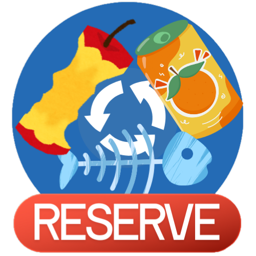

[](https://github.com/syiqi/reserve-LRPwDP-laravel12/graphs/contributors)
[](https://github.com/syiqi/reserve-LRPwDP-laravel12/network/members)
[](https://github.com/syiqi/reserve-LRPwDP-laravel12/stargazers)
[](https://github.com/syiqi/reserve-LRPwDP-laravel12/blob/main/LICENSE)

<!-- PROJECT LOGO -->
<br />
<div align="center">
  <a href="https://github.com/syiqi/reserve">
    
  </a>

  <h3 align="center">RESERVE: Leftover Reservation Platform with Dynamic Pricing</h3>

  <p align="center">
    A dual-component platform featuring a Laravel web application for perishable reservations and a Deep Reinforcement Learning (PPO) model for automated dynamic pricing.
    <br />
    <a href="https://github.com/syiqi/reserve"><strong>Explore the docs (N/A) »</strong></a>
    <br />
    <br />
    <a href="https://github.com/syiqi/reserve">View Demo (N/A)</a>
    ·
    <a href="mailto:abdul.syamir.iqmal@gmail.com">Report Bug</a>
  </p>
</div>

---

<!-- TABLE OF CONTENTS -->
<details>
  <summary>Table of Contents</summary>
  <ol>
    <li>
      <a href="#about-the-project">About The Project</a>
      <ul>
        <li><a href="#built-with">Built With</a></li>
      </ul>
    </li>
    <li><a href="#architecture">Architecture</a></li>
    <li><a href="#features">Features</a></li>
    <li>
      <a href="#getting-started">Getting Started</a>
      <ul>
        <li><a href="#prerequisites">Prerequisites</a></li>
        <li><a href="#installation">Installation</a></li>
      </ul>
    </li>
    <li><a href="#roadmap">Roadmap</a></li>
    <li><a href="#license">License</a></li>
    <li><a href="#contact">Contact</a></li>
  </ol>
</details>

---

## About The Project

**RESERVE** is an intelligent leftover reservation platform designed to reduce food waste by connecting sellers of perishable items with customers looking to reserve them. 

The system operates via two core integrated modules:
1. **LRPwDP (Laravel Web Application):** Houses the user-facing platform where sellers can list perishables and customers can browse and reserve them, backed by a MySQL database and Laravel's robust task scheduling.
2. **DRL_PPO_Model (Python Flask & Machine Learning Backend):** Utilizes a Deep Reinforcement Learning Proximal Policy Optimization (PPO) model to dynamically adjust the pricing of perishable items based on real-time internal and external indicators.

### Built With

* [![PHP][PHP.org]][PHP-url]
* [![Laravel][Laravel.org]][Laravel-url]
* [![Python][Python.org]][Python-url]
* [![Flask][Flask.org]][Flask-url]
* [![MySQL][MySQL.org]][MySQL-url]

---

## Architecture


The system works alongside a MySQL database where automated hourly triggers managed by Laravel's task scheduler connect to the Flask RESTful API. The API executes the trained DRL PPO model to recalculate and update optimal prices for available perishables in real time.

---

## Features

* **Perishable Management:** Sellers can easily list, manage, and track leftover perishable items.
* **Customer Reservations:** Seamless reservation workflow for customers to secure discounted items before expiry.
* **Dynamic Pricing Engine (DRL-PPO):** Powered by Stable-Baselines3 and Gymnasium, continuously optimizing prices to maximize sales and minimize waste.
* **Multi-Factor Pricing Strategy:**
  * *Internal Factors:* Time until expiry (`timeuntilexpiry`), quantity left (`quantityleft`), and current price (`currentPrice`).
  * *External Factors:* Real-time weather conditions via OpenWeatherMap API, day of the week, and local holidays (`holidays` library).
* **Automated Syncing:** Laravel task scheduling triggers hourly batch updates via Flask REST endpoints.

---

## Getting Started

RESERVE has two main components that run separately:

- **Laravel web application:** `LRPwDP`
- **DRL PPO pricing API:** `DRL_PPO_Model`

### Prerequisites

- PHP 8.2+
- Composer
- Python 3.10+
- pip
- MySQL
- Node.js and npm
- Git

### 1. Clone the repository

```bash
git clone https://github.com/syiqi/reserve-LRPwDP-laravel12.git
cd reserve-LRPwDP-laravel12
```

### 2. Set up the DRL PPO model

Open the Python project:

```bash
cd DRL_PPO_Model
python -m venv venv
```

Activate the virtual environment:

```bash
# Windows
venv\Scripts\activate

# macOS/Linux
source venv/bin/activate
```

Install dependencies:

```bash
pip install -r requirement.txt
```

Configure the required API keys and model settings, particularly the **OpenWeatherMap API key** used for weather-based pricing.

Start the Flask API:

```bash
python app.py
```

The API normally runs at:

```text
http://localhost:5000
```

You can test the price endpoint:

```bash
curl -X POST http://localhost:5000/predict-price \
  -H "Content-Type: application/json" \
  -d '{
    "Price": 15.0,
    "OriginalPrice": 20.0,
    "LowerBound": 10.0,
    "ExpiryHours": 72,
    "Quantity": 30,
    "TotalQuantity": 100
  }'
```

### 3. Set up the Laravel web application

Open another terminal from the repository root:

```bash
cd LRPwDP
composer install
```

Create the environment configuration:

```bash
# macOS/Linux
cp .env.example .env

# Windows
copy .env.example .env
```

Configure `LRPwDP/.env` with your MySQL database credentials:

```env
DB_CONNECTION=mysql
DB_HOST=127.0.0.1
DB_PORT=3306
DB_DATABASE=reserve
DB_USERNAME=root
DB_PASSWORD=
```

Generate the application key and initialize the database:

```bash
php artisan key:generate
php artisan migrate
php artisan db:seed
```

Install and build the frontend assets:

```bash
npm install
npm run build
```

Start Laravel:

```bash
php artisan serve
```

The web application is available at:

```text
http://127.0.0.1:8000
```

### 4. Start automated dynamic pricing

With Flask and Laravel running, open another terminal:

```bash
cd LRPwDP
php artisan schedule:work
```

This enables Laravel to trigger scheduled pricing updates through the Flask API.

### Verify the installation

- Laravel loads at `http://127.0.0.1:8000`
- Flask is reachable at `http://localhost:5000`
- `DB_*` values in `LRPwDP/.env` are valid
- The Flask pricing endpoint accepts requests
- The Laravel scheduler is running

---

## Roadmap

* [x] Core Laravel reservation platform setup
* [x] Integration of DRL PPO model with Gymnasium & Stable-Baselines3
* [x] OpenWeatherMap API and external factor integration
* [x] Automated hourly cron triggers between Laravel and Flask

---

## License

Distributed under the MIT License. See `LICENSE` for more information.

---

## Contact

Abdul Syamir Iqmal - [@LinkedIn](https://www.linkedin.com/in/abdul-syamir-iqmal/) - abdul.syamir.iqmal@gmail.com

Project Link: [https://github.com/syiqi/reserve-LRPwDP-laravel12](https://www.google.com/url?sa=E&source=gmail&q=https://github.com/syiqi/reserve-LRPwDP-laravel12)

---

[Python.org]: https://img.shields.io/badge/Python-%233776AB.svg?style=for-the-badge&logo=python&logoColor=white
[Python-url]: https://www.python.org/

[PHP.org]: https://img.shields.io/badge/php-%23777BB4.svg?style=for-the-badge&logo=php&logoColor=white
[PHP-url]: https://www.php.net/

[Laravel.org]: https://img.shields.io/badge/laravel-%23FF2D20.svg?style=for-the-badge&logo=laravel&logoColor=white
[Laravel-url]: https://laravel.com/

[MySQL.org]: https://img.shields.io/badge/mysql-%234479A1.svg?style=for-the-badge&logo=mysql&logoColor=white
[MySQL-url]: https://www.mysql.com/

[Flask.org]: https://img.shields.io/badge/flask-%23000000.svg?style=for-the-badge&logo=flask&logoColor=white
[Flask-url]: https://flask.palletsprojects.com/

[Tailwind.org]: https://img.shields.io/badge/tailwindcss-%2338B2AC.svg?style=for-the-badge&logo=tailwind-css&logoColor=white
[Tailwind-url]: https://tailwindcss.com/

[Node.org]: https://img.shields.io/badge/node.js-%23339933.svg?style=for-the-badge&logo=node.js&logoColor=white
[Node-url]: https://nodejs.org/

